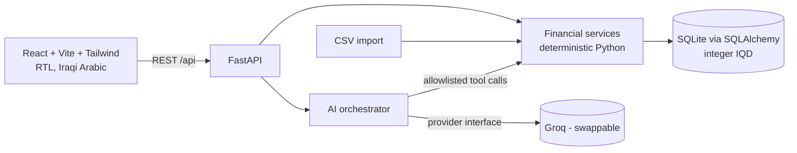

# SME & Merchant Assistant — مساعد التاجر

An AI assistant for small merchants in Iraq: record sales, expenses, supplier payments and customer
debts, then ask questions in Iraqi Arabic. **The AI never calculates money** — it calls vetted backend
functions and explains their results.

> **Status: all 5 phases built.** Backend (financial engine, REST API, CSV import, debts, reports, AI assistant with allowlisted
> tools and a number verifier), React frontend (JavaScript), an offline rules-mode assistant, an evaluation harness, failure-mode
> analysis and a demo script. **513 backend + 119 frontend tests + 19 live UI-vs-API tests pass.**
>
> **Not verified, please read:** (1) the real Groq model has **never been run** (no key was available), so its accuracy on Iraqi
> dialect, and therefore the brief's 95 % target for the intended configuration, is **unmeasured**; (2) the UI's visual layout has not
> been viewed in a browser. Details: [docs/evaluation-report.md](docs/evaluation-report.md), [docs/failure-modes.md](docs/failure-modes.md).

## Architecture


Working today: `UI`, `API`, `SVC`, `DB`, CSV import, seed data, `AI` orchestration (tested with a scripted model).

## Repository layout
```
backend/app/models/     ORM tables + enums          backend/app/services/  all financial logic
backend/app/api|schemas/ REST layer                 backend/app/ai/        provider, tools, orchestrator
backend/scripts/        seed + reset
backend/tests/          pytest suite                data/                  sample CSV
docs/                   rules, CSV schema, tasks    frontend/              React app (JavaScript)
```

## Prerequisites
Python 3.12+ (tested on 3.12.3). Node 20+ will be needed from Phase 2/4.

## Install & run (backend)
```bash
cd backend
python -m venv .venv && source .venv/bin/activate      # Windows: .venv\Scripts\activate
pip install -r requirements.txt
cp ../.env.example ../.env                              # optional until Phase 3

python -m scripts.seed_demo --reset                     # create DB + load synthetic data
uvicorn app.main:app --reload --port 8000               # API at http://localhost:8000  (docs: /docs)
python -m pytest                                        # run the test-suite
```
Reset the demo database any time: `python -m scripts.reset_demo` (or `POST /api/settings/reset-demo`).
Frontend: see [Frontend](#frontend) below.

Quick check once the server is running:
```bash
curl localhost:8000/api/health
curl localhost:8000/api/dashboard/summary
curl -F "file=@../data/sample_transactions.csv" localhost:8000/api/import/csv/preview
```

## Frontend
React 19 + Vite + Tailwind 4 in **plain JavaScript** (the brief said TypeScript; the team chose JS, with ESLint as the safety net).
Arabic RTL, seven pages, every figure from the API. Details, structure and design decisions: **[frontend/README.md](frontend/README.md)**.
```bash
cd frontend && npm install
npm run dev            # http://localhost:5173 — proxies /api to the backend on :8000 (start the backend first)
npm test               # 119 tests on real recorded API responses
npm run lint           # must be clean
npm run test:live      # opt-in: real pages vs a running backend (modifies, then resets, demo data)
```

## AI assistant modes
| `AI_PROVIDER` | What it is | Needs |
|---|---|---|
| `groq` | A real language model picks the tool and words the answer | `GROQ_API_KEY`, `GROQ_MODEL` (a model with tool calling) |
| `rules` | **Offline keyword mode**: no key, no internet. Understands common phrasings only; declines the rest instead of guessing. Clearly labelled in the UI | nothing |

Add `AI_FALLBACK_TO_RULES=true` to answer with rules mode (labelled "degraded") when the real provider has a *temporary* failure.
Placeholder values copied from `.env.example` count as "not set". All modes use the **same** allowlisted tools and the same verifier.

## AI assistant
Ask questions in Iraqi Arabic (`POST /api/assistant/chat`). The model **never calculates**: it picks one of 10
read-only allowlisted tools, the backend computes the figures, the model words them, and a verifier rejects any
number that isn't in the tool output (replacing the answer with the real figures). Full design, safety layers and
limits: **[docs/ai-architecture.md](docs/ai-architecture.md)**.

- **Without a key** the chat endpoint returns a clear Arabic `503 ai_not_configured`; everything else works.
- **Enable it:** put `GROQ_API_KEY` and `GROQ_MODEL` (a Groq model that supports tool calling) in `.env`, restart, then try
  `python -m scripts.ask "منو بعده ما دايفعلي؟" --evidence` or `curl -X POST localhost:8000/api/assistant/chat -H 'content-type: application/json' -d '{"message":"شكد مبيعاتي هذا الشهر؟"}'`.
- **Honest status:** the orchestration is tested with a scripted fake model and a mocked Groq client. How well a real model
  understands Iraqi-dialect questions is **not yet measured**; the harness is ready (`python -m evaluation.run --provider groq`).

## API
Full reference with request/response shapes: **[docs/api.md](docs/api.md)** (live Swagger UI at `/docs`).
Highlights: paginated/filterable `/api/transactions`, two-step CSV import (`preview` → `confirm`),
`/api/customers/{id}/debts` + `/payments`, `/api/dashboard/summary`, `/api/reports/*`, `/api/settings`.

## Environment variables
| name | purpose |
|---|---|
| `DATABASE_URL` | default `sqlite:///…/backend/sme_assistant.db` |
| `AI_PROVIDER` | `groq` or `rules` (offline mode) |
| `AI_FALLBACK_TO_RULES` | `true` = answer with rules mode if the AI provider is temporarily down (default off) |
| `GROQ_API_KEY`, `GROQ_MODEL` | **placeholders only** in `.env.example`; core features work without them |
| `CORS_ORIGINS` | allowed frontend origin(s) |

`.env`, databases and virtualenvs are git-ignored. Never commit real keys.

## Business rules (summary — full text in [docs/business-rules.md](docs/business-rules.md))
- Money = **integer dinars**; floats are rejected.
- Sales revenue ≠ cash received; a **credit sale** raises customer debt, a **customer payment** lowers it and is **never revenue**.
- Supplier payments settle credit purchases and are **not** a second cost.
- **Profit is an estimate** (`sales − stock purchases − expenses`); there is no inventory/COGS tracking, so cash left ≠ profit.
- Anomalies are only *flagged*; nothing is excluded automatically.

## Data
Synthetic only (fictional store, 120 days, 650 rows, planted duplicate/outlier/future-date/unreconciled
records). See [docs/synthetic-data.md](docs/synthetic-data.md) and [docs/csv-schema.md](docs/csv-schema.md).

## Tests
| Suite | Command | Result |
|---|---|---|
| Backend (engine, API, import, AI layer, evaluation harness, integration) | `cd backend && python -m pytest` | **513 passing** (~40 s) |
| Frontend components against real recorded API responses | `cd frontend && npm test` | **119 passing** |
| Frontend lint | `cd frontend && npm run lint` | clean |
| Live: real pages vs a running backend | `npm run test:live` / `npm run test:live:rules` (backend must be running; they reset the demo data) | 12 + 7 passing |

What they cover, in short: money/Arabic parsing and date boundaries; every accounting rule; debts (FIFO, overdue); anomaly flags; every
API endpoint and error shape; the whole CSV import (duplicates, bad rows, encodings, atomic rollback); the AI layer (allowlist,
read-only SQL guard, number verifier, hallucination/rounding/wrong-count/action-claim rejection, provider failures, offline mode);
the evaluation harness itself (it must be able to **fail**); cross-surface consistency (dashboard = reports = tools = independent
oracle for every period); 150 random operations that must keep the accounting identities true; a contract test that the recorded
frontend fixtures still match the live API; RTL number handling; every page and flow in the UI.
A deliberately planted accounting bug is caught by 12 tests.

## Evaluation
```powershell
cd backend
python -m evaluation.run --provider reference          # scripted perfect model: tests the PIPELINE, not language understanding
python -m evaluation.run --provider rules --heldout    # offline mode on questions it was not tuned on
python -m evaluation.safety                            # 11 kinds of deliberately misbehaving models
python -m evaluation.csv_eval                          # CSV import with faults injected at known rows
python -m evaluation.run --provider groq --pause 2     # THE REAL MODEL (needs a key): not run yet
python -m evaluation.report                            # rewrites docs/evaluation-report.md from the result files
```
Headline, honestly: the pipeline is correct (100 % on 76 questions whose expected answers come from an independent oracle),
nothing misbehaving reached the user, CSV import found 15/15 injected faults. The offline mode scored **66.7 % numerical accuracy on
held-out questions (12/18)**: the 95 % target is **not met** there, though when it answers it is right (12/12). **Real-model accuracy: not measured.**

## Demo
[docs/demo-script.md](docs/demo-script.md) is a 9-minute script with the exact numbers to expect, likely questions, and fallbacks.
Run `python -m scripts.demo_check` first: it verifies the data against the independent oracle and asks the 8 example questions.

## Roadmap
(All phases built. What remains is validation, not features: run the real model through `evaluation.run`, review the UI in a browser, add authentication.)

| Phase | Scope | State |
|---|---|---|
| 1 | monorepo, models, seed data, calculations, tests | ✅ done |
| 2 | REST API, CSV import (preview/confirm/dupes), customer payments, dashboard & reports | ✅ done |
| 3 | AI provider abstraction, allowlisted tools, number verifier, no-key handling, `/api/assistant/chat` | ✅ done |
| 4 | React frontend (JavaScript) wired to the API | ✅ done (visual review in a browser pending) |
| 5 | integration tests, Arabic evaluation (76 + 25 held-out questions), safety suite, CSV evaluation, offline mode, failure modes, demo script | ✅ done, except the real-model run |

## Known limitations (full list with mitigations: [docs/failure-modes.md](docs/failure-modes.md))
- Estimated profit is lumpy and not true net profit (no inventory).
- Overdue logic assumes FIFO allocation and a single credit-terms setting (30 days).
- **No authentication**: anyone who can reach the API can read/modify data and call the destructive `reset-demo` endpoint. Run it locally / on a trusted network only until auth is added.
- **Frontend not eyeballed in a browser**; the *currency display* setting changes the symbol in the UI's own formatting, while assistant evidence strings from the backend always say «د.ع». The UI has no authentication either.
- **The AI verifier checks numbers, not wording**; a model can still misdescribe something in words. No rate limiting on the chat endpoint.
- Single merchant, SQLite only.
- Anomaly flags are recomputed over the whole history on each list/dashboard request (fine for thousands of rows, not millions).
- Transaction search is a substring match (Arabic spelling-variant aware for the typed term, but not stemming/fuzzy).
- `DELETE` is a hard delete (use status `excluded` to keep a record that is ignored in totals).
- CSV: commas are always thousands separators; two-digit years are not accepted; no undo for a committed import.
- Cash-flow projection is a simple average, not a forecast model.

## Documentation index
[docs/api.md](docs/api.md) REST contract · [docs/business-rules.md](docs/business-rules.md) accounting definitions · [docs/csv-schema.md](docs/csv-schema.md) ·
[docs/ai-architecture.md](docs/ai-architecture.md) · [docs/evaluation-report.md](docs/evaluation-report.md) · [docs/failure-modes.md](docs/failure-modes.md) ·
[docs/demo-script.md](docs/demo-script.md) · [docs/synthetic-data.md](docs/synthetic-data.md) · [docs/TASKS.md](docs/TASKS.md) · [frontend/README.md](frontend/README.md)

## Team
Jafar Mohammed Subhi (backend, financial logic, tests) · Sharef Mohammed Sharef (frontend, AI integration, evaluation).
Task split: [docs/TASKS.md](docs/TASKS.md). Repository URL: _to be added after the GitHub repo is created._

## AI tool disclosure
Code in this repository was written with assistance from **Claude (Anthropic), model Claude Sonnet 5.5**, run via
the Claude chat interface. All generated code is reviewed and tested by the team. The runtime assistant is planned to use Groq
(model configured via environment variable).
