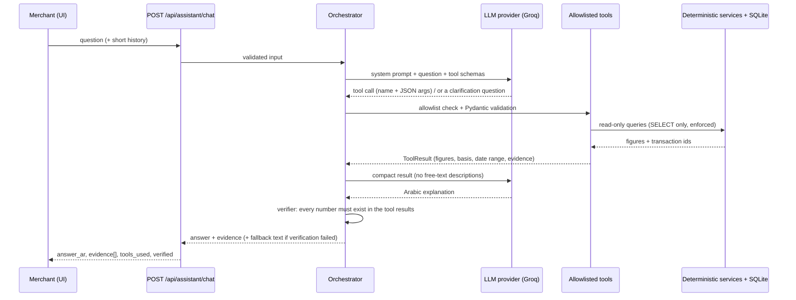

# AI assistant architecture

**Principle: the model explains; Python calculates.** The LLM never produces an authoritative number.
It chooses a tool, the backend computes the answer, and the LLM only words the result in Iraqi Arabic.



## Files (`backend/app/ai/`)
| file | role |
|---|---|
| `provider.py` | `LLMProvider.chat(messages, tools)` interface, `ProviderError(kind)`, Arabic error texts |
| `groq_provider.py` | Groq adapter (temperature 0, tool calling). Exceptions → safe `kind`, never leak keys/details |
| `tools.py` | the 10 allowlisted tools, Pydantic arg models, JSON schemas, `execute()` |
| `tool_result.py` | `ToolResult`: figures, basis, date range, evidence ids, capped transactions, Arabic fallback text |
| `readonly.py` | SQL guard: any non-`SELECT` while a tool runs raises |
| `prompts.py` | system prompt: rules, today's date, Iraqi vocabulary → tool mapping |
| `orchestrator.py` | the loop, limits, error feedback, finalisation |
| `verifier.py` | unsupported-number detection |

To add Gemini (or another model): write one class with a `chat()` method that accepts/returns the same
shapes and select it in `get_llm_provider()` (`api/assistant.py`). Nothing else changes.

## Tools (all read-only)
`get_sales_summary`, `get_expenses_summary`, `get_profit_summary`, `get_customer_debts`,
`get_customer_payment_history`, `get_recent_transactions`, `get_unreconciled_transactions`,
`compare_periods`, `get_cashflow_projection`, `get_top_customers`.

Each returns: figures (raw value **and** a display string such as `21,582,250 د.ع`), the date range,
a one-line calculation basis in Arabic, `id_groups` (transaction ids that make up each figure),
up to 25 full transactions for the UI, warnings, and `is_estimate`. Row-level tools satisfy
`sum(amount of ids) == figure` (tested). `get_cashflow_projection` is `evidence_kind: "aggregate"`
(a projection has no row-level evidence); it is always labelled an estimate.

## Safety layers
1. **Allowlist**: unknown tool names are refused (`run_sql`, `delete_transaction`… never exist). Attempting one replaces the whole answer with a read-only reply.
2. **Strict arguments**: Pydantic `extra="forbid"`, enums for periods, range checks, date validation. Errors go back to the model so it can fix the call or ask the user.
3. **Read-only**: tools use only SELECTs, and a SQLAlchemy event hook blocks any other statement while a tool runs.
4. **Ambiguity**: no default period (except "top customers" → last 30 days, stated in the answer): a missing period, ambiguous customer name, or missing comparison base produces a tool error telling the model to ask.
5. **Untrusted text**: transaction descriptions (user-entered) are never sent to the model.
6. **Loop limits**: ≤ 4 rounds, ≤ 4 calls/round, ≤ 8 calls total, give up after 3 failed calls.
7. **Number verifier** (`app/ai/verifier.py`). Every number in the answer (Western or Arabic-Indic digits) must appear among the *semantic* values of this turn's
   tool results (figures, table cells, date ranges, call arguments: **not** raw transaction-id lists), in an earlier assistant turn, or be a **small** number the user typed
   (days, ids, counts: money-sized numbers typed by the user are not trusted). Additionally:
   * numbers with a scale word (مليون، ألف…) are rejected (exact figures only);
   * a number glued to a counting noun (زبائن، فواتير، معاملات، دفعات، تنبيهات) must equal a real **count of that noun** from the tool output, not just any digit that happens to occur.
   Rejected answers are replaced by `ToolResult.render_plain()` (the real figures), `kind: "fallback"`; `unsupported_numbers` lists what was rejected.
8. **Action claims**: "تم حذف / تمت إضافة / عدلت…" are replaced by a read-only reply (the assistant cannot change data, so such a claim is always false).
9. **Estimate wording**: if an estimate tool was used and the answer never says "تقدير", a note is appended.
10. **No key / provider down**: `503 ai_not_configured` or `502 ai_<kind>`. Optional (`AI_FALLBACK_TO_RULES=true`): on a *temporary* failure the offline rules mode answers and the reply is labelled `degraded`. Auth/bad-request errors are never masked.

## Offline rules mode (`AI_PROVIDER=rules`)
`app/ai/rules_provider.py` implements the same `LLMProvider` interface with keyword intent matching (period phrases, customer-name extraction, verbs for write requests)
and `app/ai/answer_templates.py` wording. It calls the same tools and goes through the same verifier, so its numbers are exactly as trustworthy as the AI path's.
It is not a language model: on 25 held-out phrasings it answered 68 % and **declined** the rest rather than guess (see `evaluation-report.md`).
It also serves as the measurable baseline for the real model.

## Response (`POST /api/assistant/chat`)
```json
{"status":"ok","kind":"answer|clarification|message|fallback","answer_ar":"…","verified":true,
 "tools_used":["get_customer_debts"],"unsupported_numbers":[],"warnings":[],
 "evidence":[{"tool":"…","title_ar":"…","basis_ar":"…","date_range":{…},"secondary_range":null,
   "figures":[{"key","label_ar","value","display"}],"table":{"columns":[…],"rows":[…]},
   "transaction_ids":[…],"id_groups":{…},"transactions":[…25 max],"warnings":[],"is_estimate":false,
   "has_data":true,"evidence_kind":"transactions"}]}
```

## What this does NOT guarantee (read before demoing)
- **Real-model quality is unmeasured.** Only a scripted fake model and a mocked Groq client were run. Whether the chosen
  Groq model reliably picks the right tool for Iraqi-dialect questions is evaluated in Phase 5, not assumed. The system
  prompt may need tuning once real outputs are seen. The chosen model must support tool calling.
- **The verifier checks numbers, not words.** A model could still name a customer wrongly or misdescribe a trend in
  words while every number is correct. Names/dates are shown in the structured evidence so the user can check.
- **The verifier is strict**, so a correct answer phrased with a derived number (e.g. "double") may be replaced by the
  plain fallback. That is deliberate: false rejection is safer than a false claim.
- No authentication or rate limiting on the endpoint yet (every call costs provider quota).
