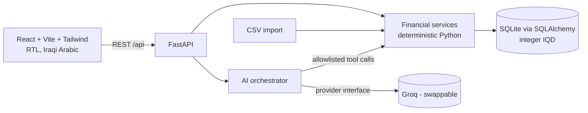

# SME & Merchant Assistant — مساعد التاجر

An AI assistant for small merchants in Iraq: record sales, expenses, supplier payments and customer
debts, then ask questions in Iraqi Arabic. **The AI never calculates money** — it calls vetted backend
functions and explains their results.

> **Status: Phase 2 of 5 complete** — data model, synthetic data, deterministic financial engine,
> REST API, CSV import, customer debts/payments, dashboard & reports (195 passing tests).
> The AI assistant (`/api/assistant/chat`) and the React UI are **not built yet** — see [Roadmap](#roadmap).

## Architecture


Working today: `API`, `SVC`, `DB`, CSV import, seed data. Planned: `AI` (Phase 3) and `UI` (Phase 4).

## Repository layout
```
backend/app/models/     ORM tables + enums          backend/app/services/  all financial logic
backend/app/api|schemas/ REST layer                 backend/app/ai/        (Phase 3)
backend/scripts/        seed + reset
backend/tests/          pytest suite                data/                  sample CSV
docs/                   rules, CSV schema, tasks    frontend/              (Phase 4)
```

## Prerequisites
Python 3.12+ (tested on 3.12.3). Node 20+ will be needed from Phase 2/4.

## Install & run (backend)
```bash
cd backend
python -m venv .venv && source .venv/bin/activate      # Windows: .venv\Scripts\activate
pip install -r requirements.txt
cp ../.env.example ../.env                              # optional until Phase 3

python -m scripts.seed_demo --reset                     # create DB + load synthetic data
uvicorn app.main:app --reload --port 8000               # API at http://localhost:8000  (docs: /docs)
python -m pytest                                        # run the test-suite
```
Reset the demo database any time: `python -m scripts.reset_demo` (or `POST /api/settings/reset-demo`).
The frontend start command will be added in Phase 4 (it doesn't exist yet).

Quick check once the server is running:
```bash
curl localhost:8000/api/health
curl localhost:8000/api/dashboard/summary
curl -F "file=@../data/sample_transactions.csv" localhost:8000/api/import/csv/preview
```

## API
Full reference with request/response shapes: **[docs/api.md](docs/api.md)** (live Swagger UI at `/docs`).
Highlights: paginated/filterable `/api/transactions`, two-step CSV import (`preview` → `confirm`),
`/api/customers/{id}/debts` + `/payments`, `/api/dashboard/summary`, `/api/reports/*`, `/api/settings`.

## Environment variables
| name | purpose |
|---|---|
| `DATABASE_URL` | default `sqlite:///…/backend/sme_assistant.db` |
| `AI_PROVIDER` | `groq` (initial provider) |
| `GROQ_API_KEY`, `GROQ_MODEL` | **placeholders only** in `.env.example`; core features work without them |
| `CORS_ORIGINS` | allowed frontend origin(s) |

`.env`, databases and virtualenvs are git-ignored. Never commit real keys.

## Business rules (summary — full text in [docs/business-rules.md](docs/business-rules.md))
- Money = **integer dinars**; floats are rejected.
- Sales revenue ≠ cash received; a **credit sale** raises customer debt, a **customer payment** lowers it and is **never revenue**.
- Supplier payments settle credit purchases and are **not** a second cost.
- **Profit is an estimate** (`sales − stock purchases − expenses`); there is no inventory/COGS tracking, so cash left ≠ profit.
- Anomalies are only *flagged*; nothing is excluded automatically.

## Data
Synthetic only (fictional store, 120 days, 650 rows, planted duplicate/outlier/future-date/unreconciled
records). See [docs/synthetic-data.md](docs/synthetic-data.md) and [docs/csv-schema.md](docs/csv-schema.md).

## Tests
`cd backend && python -m pytest` → **195 passing** (~6 s). Covered:
- **Financial engine (89):** money/Arabic parsing, periods & date boundaries, sales/expense/profit/cash formulas,
  debts incl. FIFO & overdue, payments vs credit sales, anomaly flags, period comparison, cash-flow, seed determinism,
  and an independent oracle that recomputes everything from the raw CSV.
- **API (106):** request validation and uniform errors, CRUD, filters/pagination/search, customer payments and
  overpayment rule, **CSV import** (preview writes nothing, duplicate/idempotent re-import, overlapping files,
  invalid rows with row numbers, column mapping, Arabic headers/values, cp1256, ragged/oversized/empty files,
  atomic rollback), dashboard/reports numbers vs the oracle, settings, demo-data indicators.
- A live smoke test (real `uvicorn` + `curl`) was also run once manually: health, dashboard, validation error, CSV preview, CORS, `/docs`.

Not yet built, so not tested: AI tools/provider failures, assistant endpoint, frontend.
Evaluation status: [docs/evaluation-report.md](docs/evaluation-report.md) — no AI results exist yet.

## Roadmap
| Phase | Scope | State |
|---|---|---|
| 1 | monorepo, models, seed data, calculations, tests | ✅ done |
| 2 | REST API, CSV import (preview/confirm/dupes), customer payments, dashboard & reports | ✅ done |
| 3 | AI provider abstraction, allowlisted tools, no-key fallback, `/api/assistant/chat` | next |
| 4 | React frontend wired to the API | — |
| 5 | integration tests, Arabic evaluation set + real report, demo | — |

## Known limitations (so far)
- Estimated profit is lumpy and not true net profit (no inventory).
- Overdue logic assumes FIFO allocation and a single credit-terms setting (30 days).
- **No authentication**: anyone who can reach the API can read/modify data and call the destructive `reset-demo` endpoint. Run it locally / on a trusted network only until auth is added.
- Single merchant, SQLite only.
- Anomaly flags are recomputed over the whole history on each list/dashboard request (fine for thousands of rows, not millions).
- Transaction search is a substring match (Arabic spelling-variant aware for the typed term, but not stemming/fuzzy).
- `DELETE` is a hard delete (use status `excluded` to keep a record that is ignored in totals).
- CSV: commas are always thousands separators; two-digit years are not accepted; no undo for a committed import.
- Cash-flow projection is a simple average, not a forecast model.

## Team
Jafar Mohammed Subhi (backend, financial logic, tests) · Sharef Mohammed Sharef (frontend, AI integration, evaluation).
Task split: [docs/TASKS.md](docs/TASKS.md). Repository URL: _to be added after the GitHub repo is created._

## AI tool disclosure
Code in this repository was written with assistance from **Claude (Anthropic), model Claude Sonnet 5.5**, run via
the Claude chat interface. All generated code is reviewed and tested by the team. The runtime assistant is planned to use Groq
(model configured via environment variable).
